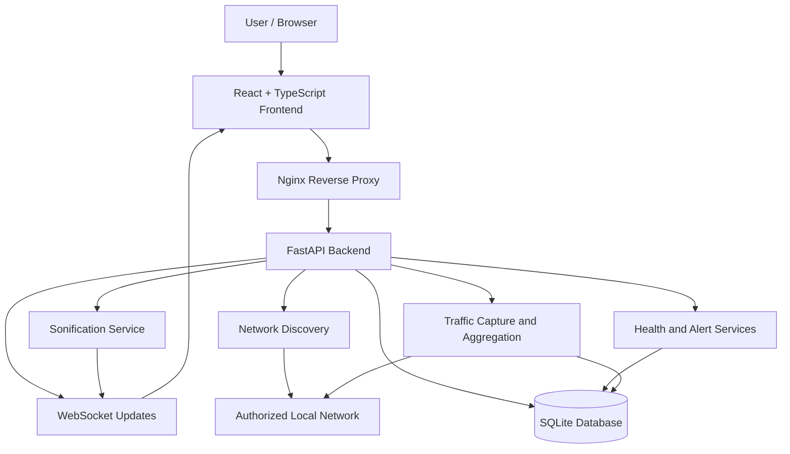
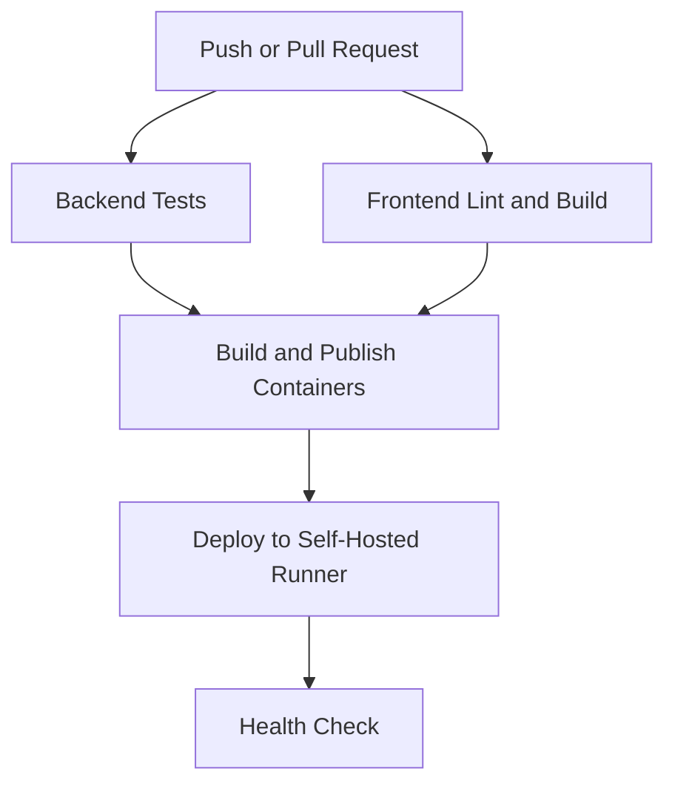

# 🎧 NetSonic

<div align="center">

# NetSonic

### See the network. Hear its rhythm.

**A local network observability dashboard with real-time traffic visualization, network health monitoring, and audio sonification.**

[](https://www.python.org/)
[](https://fastapi.tiangolo.com/)
[](https://react.dev/)
[](https://www.typescriptlang.org/)
[](https://sqlite.org/)
[](https://podman.io/)
[](https://github.com/features/actions)
[](LICENSE)

</div>

---

## 📖 Description

**NetSonic** is a local network observability and traffic sonification platform designed to make network activity easier to understand through visual analytics and sound.

It discovers devices on authorized local networks, monitors live packet activity, visualizes network topology, tracks historical telemetry, and translates traffic patterns into musical output.

Instead of relying entirely on charts and numerical metrics, NetSonic lets you **hear network activity as it happens**.

The project combines a React and TypeScript frontend with a FastAPI backend, WebSocket-based updates, packet capture, and persistent telemetry storage.

## 🗺️ Table of Contents

- [✨ Features](#-features)
- [🛠️ Tech Stack](#️-tech-stack)
- [🏗️ Architecture](#️-architecture)
- [📂 Project Structure](#-project-structure)
- [🚀 Getting Started](#-getting-started)
- [🐳 Container Deployment](#-container-deployment)
- [⚙️ CI/CD Pipeline](#️-cicd-pipeline)
- [🌐 Public Demo](#-public-demo)
- [🔌 API Overview](#-api-overview)
- [🎵 How Sonification Works](#-how-sonification-works)
- [🧪 Testing](#-testing)
- [🔐 Security and Privacy](#-security-and-privacy)
- [🛠️ Troubleshooting](#️-troubleshooting)
- [🗺️ Roadmap](#️-roadmap)

---

## ✨ Features

### 🔍 Local Network Discovery

- Discover devices on an authorized IPv4 subnet.
- Inspect available network interfaces.
- View device IP addresses, MAC addresses, and hostnames when available.
- Track first-seen and last-seen timestamps.
- Mark known devices offline when they fail to respond during a subsequent discovery scan.

### 📡 Live Traffic Monitoring

- Monitor captured network traffic in real time.
- View packet counts, traffic rates, protocols, and traffic direction.
- Identify top communicating peers.
- Inspect upload and download activity.
- Filter traffic by protocol and peer IP address.
- Configure packet-rate and bandwidth alert thresholds.

### 🗺️ Network Topology

- Visualize the local machine, gateway, and discovered devices.
- Explore inferred relationships between network devices.
- Understand the structure of the observed local network through an interactive topology view.

### 📊 Historical Telemetry

- Store aggregate traffic samples every 15 seconds while packet capture is active.
- Retain up to seven days of telemetry in SQLite.
- Explore traffic trends over 5-minute, 1-hour, 24-hour, and 7-day windows.
- View upload and download rate history.
- Inspect historical packet and byte totals in device details.

### 💚 Network Health Monitoring

- Display a heuristic network health score from 0 to 100.
- Monitor gateway latency, packet loss, jitter, availability, and traffic health.
- Collect gateway measurements using periodic ICMP probes while capture is running.
- View current health metrics and historical trends.

The score is an operational indicator, not a guarantee of network health or a diagnostic result.

### 🚨 Network Alerts

Generate alerts for events such as:

- Newly discovered devices.
- Devices becoming offline after a discovery scan.
- High packet rates and traffic spikes.
- High gateway latency and packet loss.
- Packet-rate anomalies relative to recent samples.

Repeated threshold events are deduplicated by event type and day in the current implementation.

### 🎧 Network Audio Sonification

- Translate live traffic activity into musical phrases.
- Select instrument sounds and configure sonification settings.
- Map traffic rate to tempo and traffic intensity to note velocity.
- Use inbound and outbound direction to control stereo positioning.
- Preview instrument samples independently of live traffic.
- Display the live traffic-to-sound mapping, including packet rate, tempo, last note, and playback state.

Audio playback requires explicit user interaction in the browser.

### 🔬 Traffic Investigation and Session Recording

- Record recent traffic summaries as one-second samples.
- Replay recorded sessions through historical time-series views.
- Export selected sessions or the current traffic snapshot as CSV or JSON.
- Export aggregate metadata without storing packet payloads.
- Filter dashboard charts and live sonification using protocol and peer-IP selectors.

Browser-based session history is separate from the backend's persistent telemetry.

### 🎨 Customizable Dashboard

- Show or hide Discovery, Topology, Traffic, and Sonification panels.
- Reorder dashboard panels.
- Save dashboard layout and preferences in the browser.
- Configure alert thresholds and view saved capture sessions.

### 📚 In-App Learning Guide

Visit `/learn` to access the application's learning guide.

---

## 🛠️ Tech Stack

| Component | Technologies |
|---|---|
| Frontend | React, TypeScript, Vite |
| UI and visualization | CSS, Recharts, Cytoscape |
| Backend | Python, FastAPI, Uvicorn |
| Networking | Scapy, packet capture, ICMP probes |
| API communication | REST APIs, WebSockets |
| Database | SQLite, SQLAlchemy |
| Containers | Podman, Compose |
| Container registry | GitHub Container Registry (GHCR) |
| CI/CD | GitHub Actions |
| Public demo access | Cloudflare Tunnel |

---

## 🏗️ Architecture



### Architecture overview

- **Frontend:** Displays dashboard panels, charts, device information, topology, and audio controls.
- **Nginx:** Serves the production frontend and proxies API and WebSocket requests to the backend.
- **FastAPI:** Provides REST endpoints and coordinates discovery, monitoring, telemetry, health, alerts, and sonification.
- **WebSockets:** Deliver live sonification updates to the browser.
- **SQLite:** Persists device inventory and aggregate historical telemetry.
- **Scapy:** Supports packet capture and network discovery operations, subject to operating-system permissions.

---

## 📂 Project Structure

```text
NetSonic/
├── backend/
│   ├── app/
│   │   ├── api/              # REST and WebSocket endpoints
│   │   ├── core/             # Configuration, logging, exceptions
│   │   ├── db/               # Database setup and sessions
│   │   ├── discovery/        # Local network discovery
│   │   ├── models/           # Database models
│   │   ├── schemas/          # Request and response schemas
│   │   ├── sonification/     # Audio configuration and services
│   │   ├── topology/         # Network topology
│   │   ├── traffic/          # Packet capture and aggregation
│   │   └── main.py           # FastAPI application
│   ├── tests/                # Backend tests
│   ├── .env.example
│   └── requirements.txt
├── frontend/
│   ├── public/               # Static assets and audio samples
│   ├── src/
│   │   ├── assets/
│   │   ├── components/       # Dashboard, traffic, topology, audio
│   │   ├── pages/            # Dashboard and Learn pages
│   │   ├── services/         # API and WebSocket clients
│   │   └── App.tsx
│   ├── .env.example
│   └── package.json
├── docs/                     # Documentation and design notes
├── .github/
│   └── workflows/
│       └── ci.yml            # CI/CD workflow
└── README.md
```

---

## 🚀 Getting Started

### Prerequisites

Install the following:

- Python 3.11 or newer.
- Node.js 22 or a compatible version.
- npm.
- Git.
- Appropriate permissions for packet capture and network discovery.

The exact minimum versions should be checked against the dependency files in the repository.

### 1. Clone the repository

```bash
git clone https://github.com/Batman0603/NetSonic.git
cd NetSonic
```

### 2. Configure the backend

```bash
cd backend

python3 -m venv .venv
source .venv/bin/activate

python -m pip install --upgrade pip
pip install -r requirements.txt

cp .env.example .env
```

On Windows PowerShell, activate the virtual environment using:

```powershell
.\.venv\Scripts\Activate.ps1
```

### 3. Start the backend

From the `backend/` directory:

```bash
python -m uvicorn app.main:app --reload --host 127.0.0.1 --port 8000
```

The API is available at:

- API: `http://127.0.0.1:8000`
- Interactive API documentation: `http://127.0.0.1:8000/docs`
- Health endpoint: `http://127.0.0.1:8000/api/health`

### 4. Start the frontend

Open a second terminal:

```bash
cd NetSonic/frontend

npm install
cp .env.example .env
npm run dev
```

Open the local development URL printed by Vite, normally:

`http://localhost:5173`

Ensure that `VITE_API_BASE_URL` in `frontend/.env` points to the running backend when using the local development setup.

Example:

```dotenv
VITE_API_BASE_URL=http://127.0.0.1:8000
```

### 5. Start using NetSonic

1. Open the dashboard.
2. Select the appropriate local network interface.
3. Scan only an authorized subnet.
4. Start traffic monitoring.
5. Explore live traffic, device information, topology, historical metrics, and alerts.
6. Select an instrument and press **Start Audio** to enable sonification.
7. Use **Preview sample** to test the selected sound independently of live traffic.

---

## 🐳 Container Deployment

NetSonic supports a container-based deployment using Podman and Compose.

The deployed setup uses:

- A backend container for FastAPI.
- A frontend container serving the production UI through Nginx.
- GitHub Container Registry for published images.
- A persistent volume for the SQLite database.
- An internal Compose network for frontend-to-backend communication.

### Start the deployed application

From the directory containing your Compose configuration:

```bash
podman compose up -d
```

Inspect the running containers:

```bash
podman ps
```

Check the application health endpoint:

```bash
curl -i http://localhost:8080/api/health
```

Open:

`http://localhost:8080`

### View logs

```bash
podman compose logs -f
```

To inspect a specific service:

```bash
podman logs -f netsonic-backend
podman logs -f netsonic-frontend
```

### Update the deployed application

After the images have been published to GHCR:

```bash
podman compose pull
podman compose up -d
```

Use the repository's configured deployment workflow when deploying by commit-specific image tags.

**Persistence warning:** Do not run `podman compose down -v` unless you intentionally want to delete the Compose-managed database volume and its stored data.

---

## ⚙️ CI/CD Pipeline

NetSonic uses GitHub Actions to automate validation, container publishing, and deployment.

### Pipeline stages



### What the pipeline does

1. **Backend validation:** Runs automated tests and Python compilation checks.
2. **Frontend validation:** Installs dependencies and runs linting and the production build.
3. **Container publishing:** Builds and publishes backend and frontend images to GHCR.
4. **Deployment:** Uses a configured self-hosted Linux runner to pull the appropriate images and restart the Compose deployment.
5. **Health verification:** Checks that the deployed API responds successfully.

### Deployment requirements

The self-hosted runner must be online for the deployment job to execute. GHCR authentication must also be configured correctly.

Required repository secrets for the documented deployment workflow:

- `GHCR_USERNAME`
- `GHCR_READ_TOKEN`

Use a token with only the required permissions. Never commit credentials or expose token values in logs.

View workflow runs:

[GitHub Actions — NetSonic](https://github.com/Batman0603/NetSonic/actions)

---

## 🌐 Public Demo

NetSonic can be shared temporarily through a Cloudflare Quick Tunnel while the application runs on your own machine.

Start the tunnel after confirming that the local application is healthy:

```bash
cloudflared tunnel --url http://localhost:8080
```

Cloudflare will print a temporary public HTTPS URL ending in `trycloudflare.com`.

**Important limitations:**

- The generated hostname is temporary and may change when you restart the tunnel.
- Your Fedora machine and application must remain running.
- A Quick Tunnel is intended for development and demonstration, not guaranteed production availability.
- Anyone able to reach the public URL may attempt to access the exposed application unless you add appropriate access controls.

Do not expose network discovery, monitoring controls, or sensitive data publicly without suitable authentication and authorization.

For a stable hostname, configure a named Cloudflare Tunnel with a domain you control.

---

## 🔌 API Overview

The following routes describe the main API capabilities documented for NetSonic.

| Endpoint | Purpose |
|---|---|
| `GET /api/health` | Check API health |
| `GET /api/interfaces` | List local network interfaces |
| `POST /api/discovery/scan` | Scan an authorized IPv4 subnet |
| `GET /api/devices` | List known devices |
| `GET /api/devices/{id}` | Retrieve device details |
| `GET /api/devices/{id}/traffic` | Retrieve device traffic history |
| `GET /api/topology` | Retrieve network topology |
| `POST /api/traffic/start` | Start traffic monitoring |
| `POST /api/traffic/stop` | Stop traffic monitoring |
| `GET /api/traffic/status` | Retrieve monitoring status |
| `GET /api/traffic/snapshot` | Retrieve the current traffic summary |
| `POST /api/sonification/start` | Start sonification |
| `POST /api/sonification/stop` | Stop sonification |
| `GET /api/sonification/config` | Read sonification settings |
| `PUT /api/sonification/config` | Update sonification settings |
| `WS /api/sonification/stream` | Receive live sonification updates |
| `GET /api/history/traffic` | Retrieve historical traffic trends |
| `GET /api/health/network` | Retrieve current network health |
| `GET /api/health/network/history` | Retrieve network health history |
| `GET /api/alerts` | Retrieve recent network alerts |

Use the interactive API documentation at `/docs` to inspect the available request schemas and responses.

---

## 🎵 How Sonification Works

NetSonic maps aggregate network activity to musical parameters.

| Network signal | Musical mapping |
|---|---|
| Packet rate | Tempo |
| Traffic intensity | Note velocity |
| Inbound/outbound direction | Stereo position |
| Pitch configuration | Notes within a pentatonic scale |
| Traffic pattern bands | Changes in phrase patterns |

Instrument samples provide the sound of individual notes. The application triggers short musical phrases rather than continuously playing one long recording.

The drums option uses a kick, snare, and hi-hat pattern, with tempo and velocity responding to traffic activity.

Playback becomes silent when the measured packet rate reaches zero or capture updates become stale.

Use **Preview sample** to test an instrument without depending on network traffic. Use **LIVE TRAFFIC → SOUND** to inspect the current traffic-to-audio mapping.

---

## 🧪 Testing

Run backend tests:

```bash
cd backend
source .venv/bin/activate
python -m pytest -v
```

Run frontend linting and build checks:

```bash
cd frontend
npm run lint
npm run build
```

The GitHub Actions workflow runs automated validation when changes are pushed or pull requests are opened.

---

## 🔐 Security and Privacy

- **Authorized networks only:** Scan networks you own or have explicit permission to assess.
- **Packet capture permissions:** Scapy may require raw-packet capture privileges depending on the operating system.
- **Payload privacy:** Traffic investigation and exports use aggregate metadata; packet payloads are not stored by these features.
- **Local session recordings:** Browser-based recordings are saved locally and are separate from backend historical telemetry.
- **Public access:** Add authentication and authorization before exposing monitoring or discovery controls to untrusted users.
- **Secrets:** Keep tokens, passwords, and private configuration out of Git.
- **Audio:** Browser playback requires user interaction. Initial sample loading may require internet access.

Network discovery results and health metrics depend on the selected interface, host permissions, and the devices responding on the network.

---

## 🛠️ Troubleshooting

| Problem | Suggested check |
|---|---|
| Frontend cannot reach the API | Confirm that FastAPI is running and check `VITE_API_BASE_URL`. |
| No network interfaces appear | Confirm the host has an active IPv4 interface. |
| Traffic remains empty | Verify capture permissions and that the selected interface is active. |
| Discovery fails | Check that the subnet belongs to the selected interface and stays within the supported scan limit. |
| Gateway health metrics are unknown | Allow time for ICMP probes and verify host permissions and gateway reachability. |
| Sonification is silent | Press **Start Audio**, allow samples to load, and check browser and system volume. |
| Container returns HTTP 502 | Inspect backend logs, Compose networking, and Nginx upstream resolution. |
| Container image pull fails | Verify GHCR credentials and image permissions. |
| Deployment job remains queued | Confirm that the self-hosted runner is online and has the required labels. |
| Port is already in use | Stop the conflicting process or update the published port mapping. |
| Historical data is missing | Check the persistent database volume and confirm that telemetry collection has run. |

---

## 🗺️ Roadmap

Potential future improvements include:

- [ ] Authentication and role-based access control.
- [ ] More granular network traffic filtering and investigation.
- [ ] Configurable alert rules and notification channels.
- [ ] Improved topology discovery and device identification.
- [ ] Additional sonification instruments and mapping profiles.
- [ ] Enhanced deployment security and monitoring.
- [ ] Expanded automated testing and deployment verification.

These are prospective improvements, not claims that the features are already implemented.

---

## 🤝 Contributing

Contributions, bug reports, and feature suggestions are welcome.

1. Fork the repository.
2. Create a feature branch.
3. Make your changes and run the available checks.
4. Submit a pull request describing the changes.

Please avoid including private network data, credentials, or sensitive packet information in issues and pull requests.

---

## 📄 License

See the repository's [LICENSE](LICENSE) file for the applicable license terms.

---

<div align="center">

**NetSonic** · A clearer picture of the traffic around you.

*See the network. Hear the network.*

</div>